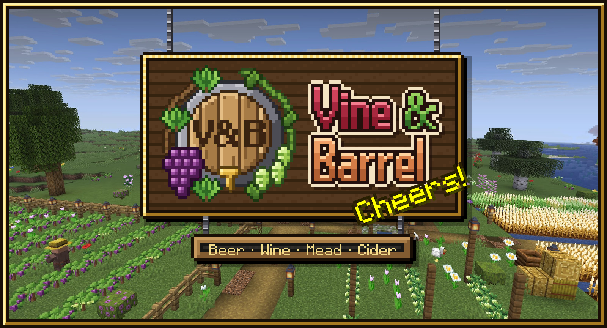
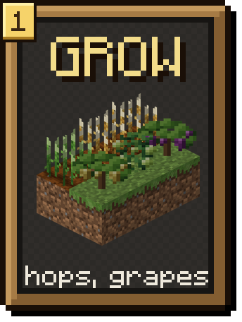
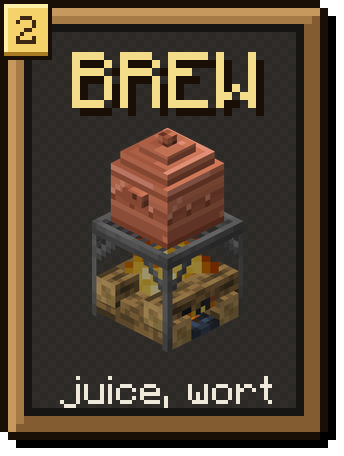
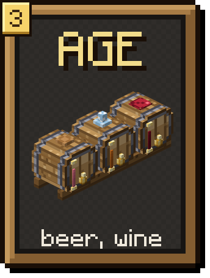
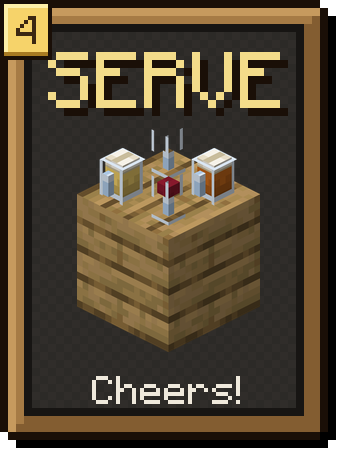
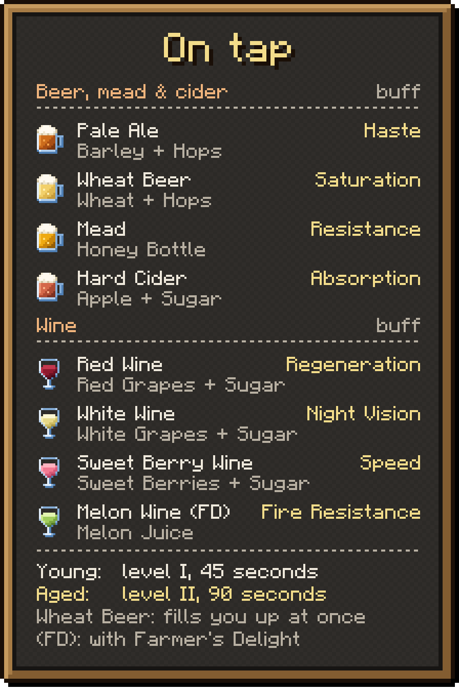
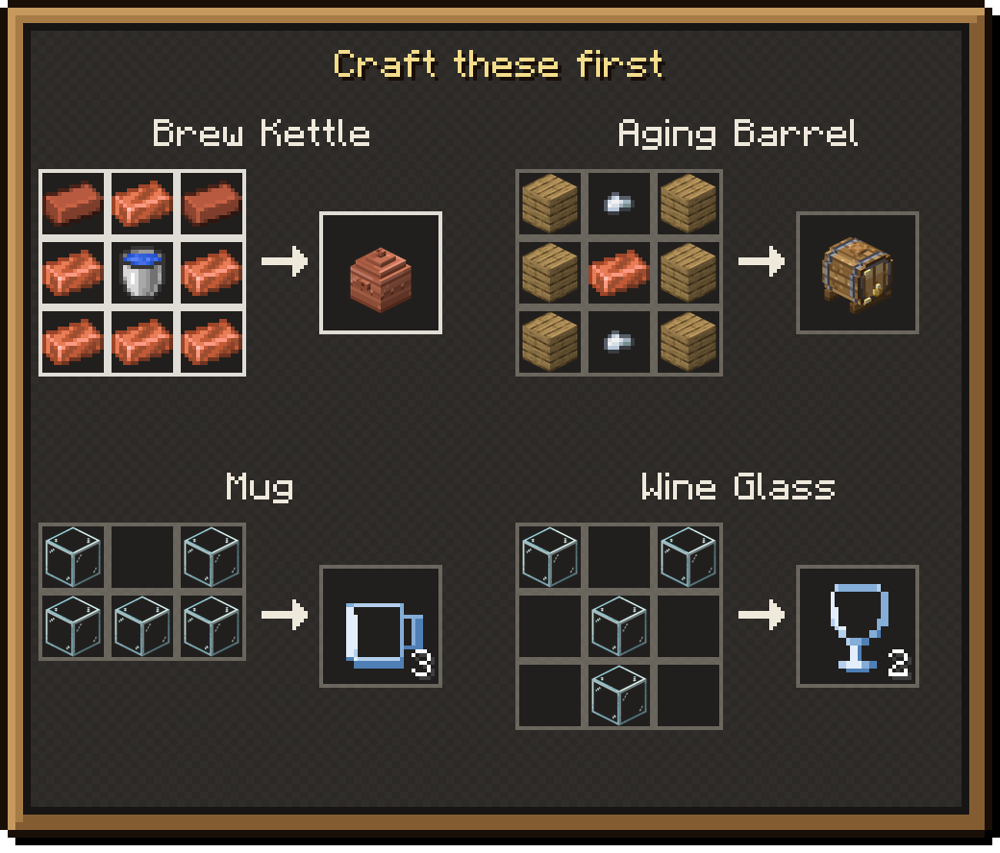
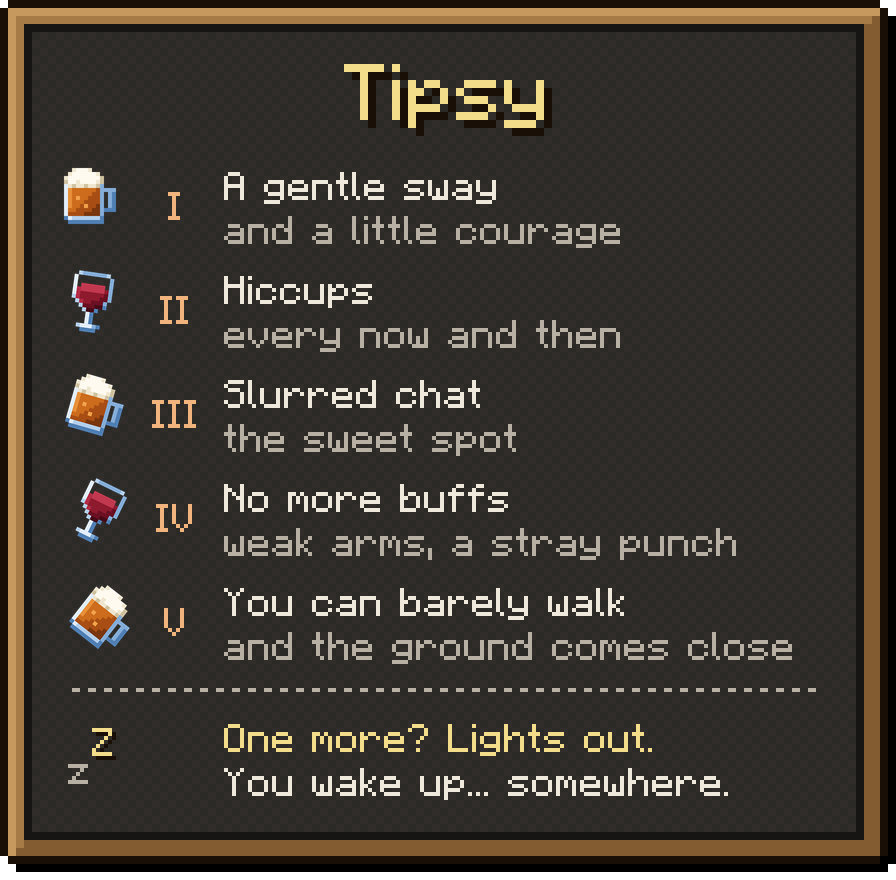

<b>A cozy brewing mod: beer, wine, mead and cider.</b> 
Grow the crops, boil them in a copper kettle, age them in oak barrels, and pour a round for your friends.

 

<b><a href="https://jexxme.github.io/VineAndBarrel/">Wiki</a> · <a href="https://github.com/jexxme/VineAndBarrel">Source</a> · <a href="https://github.com/jexxme/VineAndBarrel/issues">Issues</a></b>

   

Everything happens right in the world. The kettle bubbles on the fire, the barrel's airlock blubs while it ferments, and a cork pops when the batch is aged. The secret ingredient is patience. It's a whole mod on its own, and it fits right in with Farmer's Delight.

Every recipe, every number, every drink: <b><a href="https://jexxme.github.io/VineAndBarrel/">the wiki</a></b>, in 12 languages.

- **Find your first crops.** Wild hops, grapes and barley grow out in the world. Village farms grow them too, and farmers and the wandering trader sell seeds.
- **Or visit a tavern first.** About one village in three has one, with full barrels to taste and seeds in the chest.
- **Craft a kettle, a barrel and some mugs:**

- **Hops and grapes**, red or white, grow on bushes. Plant the fruit, pick it when it's ripe, and the bush fruits again. Can't wait? Pick it half-ripe for a smaller handful.
- **Trellis:** five sticks make four. Put one on a bush, and once the bush is ripe it climbs, up to 3 blocks tall, fruiting all the way up.
- **Barley** grows on farmland, just like wheat.
- Bees help your crops grow. Foxes steal ripe grapes, and horses and llamas love barley.

*[More on the wiki →](https://jexxme.github.io/VineAndBarrel/crops/)*

The **Brew Kettle** is a copper pot. Set it over a campfire, a fire, lava or a magma block.

- **Four fruit and a sugar** make juice. **Three barley or wheat and a hop** make wort, which is beer before it ferments. **Three honey bottles** make honey must for mead.
- Ten seconds later, four servings wait under the lid. Fill bottles or buckets from the kettle, like a cauldron.
- Hoppers can run it for you.
- The kettle weathers like any copper. Wax it to keep the shine.
- The juices are good drinks too, and they sober you up a little.

*[More on the wiki →](https://jexxme.github.io/VineAndBarrel/brew-kettle/)*

Pour the brew into an **Aging Barrel** and wait. The barrel shows you everything itself, no menu needed.

- After **one day** (20 minutes of play) it has fermented into a young drink. The airlock on top bubbles meanwhile.
- **Three days later** it's **aged**: a deeper colour, a little shimmer and a stronger buff.
- A barrel holds **8 servings**, two buckets' worth. Right-click it with an empty hand to see how long is left.
- Barrels join into racks and stack into walls. Hoppers and dispensers fill and empty them.

*[More on the wiki →](https://jexxme.github.io/VineAndBarrel/aging-barrel/)*

Right-click a barrel with a **Mug** for beer, mead and cider, or a **Wine Glass** for wine.

- **Set your drink down.** Sneak and right-click a block. Four fit on one block, and aged ones shimmer there too.
- **Cheers!** Finish a drink within 3 seconds of a friend, up to 5 blocks apart. Glasses ring, mugs clunk, and both buffs last 20% longer.

Every drink adds a level of **Tipsy**, up to five. The first three are the fun part.

- **From level IV**, drinks stop giving buffs and villagers won't trade with you. Now and then your fist swings at whatever is in front of you.
- **One more at level V** and it's lights out. Where you wake up depends on the night. You wake up hungry, but you never lose any items.
- **To sober up**, wait (90 seconds a level), drink water, juice or milk, or sleep through the night.

*[More on the wiki →](https://jexxme.github.io/VineAndBarrel/tipsy/)*

About **one village in three** has a tavern, built in its village's style: plains, desert, savanna, snowy or taiga. Each village type has two layouts, and no two taverns are quite alike.

- Behind the bar, stairs lead down to a vaulted **barrel cellar**.
- Each one has a feature of its own: a beer garden, a roof terrace, a veranda bar, a hearth room or a mead hall.
- The barrels are already full, and some are aged. Bring a mug.
- The tavern chest has seeds, mugs and glasses to start your own brewery.

*[More on the wiki →](https://jexxme.github.io/VineAndBarrel/villages/)*

Vine & Barrel works fine on its own. Add Farmer's Delight and the two fit together:

- The **stove** heats the kettle.
- Grape and hop bushes climb **ropes** just like a trellis, and **rich soil** helps your crops grow.
- Farmer's Delight's **apple cider** ages into Hard Cider, and its **melon juice** into **Melon Wine**.
- The **cooking pot** cooks with your drinks and barley: **Beer-Battered Fish**, **Wine-Braised Beef**, **Cider-Braised Pork**, **White Wine Risotto** and **Barley Mutton Broth**.
- **Coq au Vin** is a feast: one pot of it serves four bowls.
- **Beer Bread** is made from wheat and a beer, and FD's knife cuts **straw** from barley.

That's [Farmer's Delight Neoforged](https://modrinth.com/mod/farmers-delight-neoforged) on NeoForge and [Farmer's Delight Refabricated](https://modrinth.com/mod/farmers-delight-refabricated) on Fabric.

*[More on the wiki →](https://jexxme.github.io/VineAndBarrel/farmers-delight/)*

All optional. They switch on by themselves.

- **JEI:** the kettle and barrel recipes, with their times.
- **Jade:** what's in a kettle or barrel, and how long it has left.
- **AppleSkin:** food previews, wheat beer included.
- **Tough As Nails**, **Homeostatic** and **Thirst Was Taken 2:** drinks quench your thirst.
- **Nutritional Balance** (NeoForge) and **Spice of Life Onion:** food groups and variety.
- **Serene Seasons** and **Biomes O' Plenty:** crop seasons, and wild crops in more biomes.
- **Mod Menu** (Fabric): the settings screen.

- **Non-alcoholic mode.** One server setting turns Tipsy off. The drinks keep their names and their buffs.
- **Motion sickness?** Set the sway to 0 in your client settings and Tipsy never moves your screen. The vision effects and other players' sway can be switched off too.
- Server owners can turn off slurred chat, stumbling, lights out and stray punches one by one.
- **All in game:** Mods, Vine & Barrel, Config on NeoForge, or the same button with [Mod Menu](https://modrinth.com/mod/modmenu) on Fabric.

*[More on the wiki →](https://jexxme.github.io/VineAndBarrel/reference/config/)*

Pick the loader your game or modpack uses, NeoForge or Fabric. Put the same file on the server and in every player's `mods` folder.

| Minecraft | NeoForge | Fabric |
|:--|:--|:--|
| **26.3** | ✅ Vine & Barrel 1.0 | ✅ Vine & Barrel 1.0 |

Older Minecraft versions (26.1–26.2, NeoForge): planned.

- **Minecraft 26.3** needs NeoForge 26.3.0.101 or newer, or Fabric Loader 0.20.1 and [Fabric API](https://modrinth.com/mod/fabric-api) 0.165.2 or newer.
- The file name tells you the loader: `…+neoforged.1.jar` is NeoForge, `…+fabric.1.jar` is Fabric.

- **Do I need Farmer's Delight?** No. Vine & Barrel is a complete mod on its own.
- **NeoForge or Fabric?** Both, with the same content, and both are full releases on Minecraft 26.3. NeoForge builds for older Minecraft versions are planned.
- **Can I use it in my modpack?** Yes, go ahead. It's MIT licensed.
- **Is this part of Farmer's Delight?** No. Farmer's Delight is vectorwing's mod. Vine & Barrel is a separate project made to sit next to it, and it isn't affiliated with or endorsed by vectorwing.
- **Found a bug, or have an idea?** Open an issue on [GitHub](https://github.com/jexxme/VineAndBarrel/issues). The [wiki](https://jexxme.github.io/VineAndBarrel/) has every recipe and every number, in 12 languages.

Bug reports and pull requests are welcome. How to build, test and work on the Minecraft version branches: [CONTRIBUTING.md](CONTRIBUTING.md).

Made by **Jexxme**, under the [MIT License](https://github.com/jexxme/VineAndBarrel/blob/26.3/LICENSE).

Some art, the kettle's boiling sounds and some code come from Farmer's Delight by **vectorwing** and its contributors, under MIT: the Brew Kettle, which follows Farmer's Delight's cooking pot, the Coq au Vin feast, which follows its feasts, rope climbing, and the wild crops with their biome filter. See [NOTICE_farmersdelight.txt](https://github.com/jexxme/VineAndBarrel/blob/26.3/NOTICE_farmersdelight.txt).
