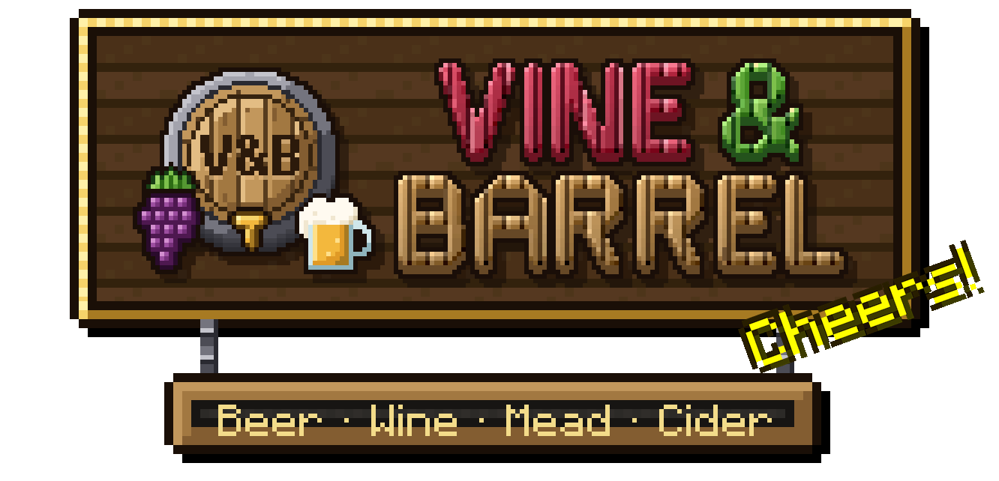

<p align="center" style="text-align:center"></p>

<p align="center" style="text-align:center"><b>A cozy brewing mod for Minecraft: beer, wine, mead and cider.</b><br>
Grow the crops, boil them in a copper kettle, age them in oak barrels, and pour a round for your friends.</p>

<p align="center" style="text-align:center"><a href="https://www.curseforge.com/minecraft/mc-mods/vine-and-barrel"></a> <a href="https://jexxme.github.io/VineAndBarrel/"></a></p>

## The wiki

**[jexxme.github.io/VineAndBarrel](https://jexxme.github.io/VineAndBarrel/)** has everything about playing the mod, with every recipe and number, in 12 languages.

- **[Getting started](https://jexxme.github.io/VineAndBarrel/getting-started/):** from the first vine to the first glass.
- **[Crops](https://jexxme.github.io/VineAndBarrel/crops/)**, the **[Brew Kettle](https://jexxme.github.io/VineAndBarrel/brew-kettle/)** and the **[Aging Barrel](https://jexxme.github.io/VineAndBarrel/aging-barrel/):** growing, brewing and aging.
- **[Drinks](https://jexxme.github.io/VineAndBarrel/drinks/)** and **[Tipsy](https://jexxme.github.io/VineAndBarrel/tipsy/):** what each drink gives you, and what one too many does.
- **[Villages](https://jexxme.github.io/VineAndBarrel/villages/)** and **[Compatibility](https://jexxme.github.io/VineAndBarrel/compatibility/):** taverns, and the mods it works with.
- **[All recipes](https://jexxme.github.io/VineAndBarrel/reference/recipes/)** and **[all items and blocks](https://jexxme.github.io/VineAndBarrel/items/)**.

The tour with pictures is on the [CurseForge page](https://www.curseforge.com/minecraft/mc-mods/vine-and-barrel).

## Download

Find your Minecraft version and your loader. Put the same file on the server and in every player's `mods` folder.

| Minecraft | NeoForge | Forge | Fabric |
|:--|:--|:--|:--|
| **26.3** | ✅ [Vine & Barrel 1.1.1](https://github.com/jexxme/VineAndBarrel/releases/download/26.3-1.1.1%2Bneoforged.1/VineAndBarrel-26.3-1.1.1%2Bneoforged.1.jar) | — | ✅ [Vine & Barrel 1.1.1](https://github.com/jexxme/VineAndBarrel/releases/download/26.3-1.1.1%2Bneoforged.1/VineAndBarrel-26.3-1.1.1%2Bfabric.1.jar) |
| **26.2** | ✅ [Vine & Barrel 1.1.1](https://github.com/jexxme/VineAndBarrel/releases/download/26.2-1.1.1%2Bneoforged.1/VineAndBarrel-26.2-1.1.1%2Bneoforged.1.jar) | — | ✅ [Vine & Barrel 1.1.1](https://github.com/jexxme/VineAndBarrel/releases/download/26.2-1.1.1%2Bneoforged.1/VineAndBarrel-26.2-1.1.1%2Bfabric.1.jar) |
| **26.1.2** | ✅ [Vine & Barrel 1.1.1](https://github.com/jexxme/VineAndBarrel/releases/download/26.1.2-1.1.1%2Bneoforged.1/VineAndBarrel-26.1.2-1.1.1%2Bneoforged.1.jar) | — | ✅ [Vine & Barrel 1.1.1](https://github.com/jexxme/VineAndBarrel/releases/download/26.1.2-1.1.1%2Bneoforged.1/VineAndBarrel-26.1.2-1.1.1%2Bfabric.1.jar) |
| **26.1 / 26.1.1** | ✅ [Vine & Barrel 1.1.1](https://github.com/jexxme/VineAndBarrel/releases/download/26.1.1-1.1.1%2Bneoforged.1/VineAndBarrel-26.1.1-1.1.1%2Bneoforged.1.jar) | — | ✅ [Vine & Barrel 1.1.1](https://github.com/jexxme/VineAndBarrel/releases/download/26.1.1-1.1.1%2Bneoforged.1/VineAndBarrel-26.1.1-1.1.1%2Bfabric.1.jar) |
| **1.21.1** | ✅ [Vine & Barrel 1.1.1](https://github.com/jexxme/VineAndBarrel/releases/download/1.21.1-1.1.1%2Bneoforged.1/VineAndBarrel-1.21.1-1.1.1%2Bneoforged.1.jar) | — | ✅ [Vine & Barrel 1.1.1](https://github.com/jexxme/VineAndBarrel/releases/download/1.21.1-1.1.1%2Bneoforged.1/VineAndBarrel-1.21.1-1.1.1%2Bfabric.1.jar) |
| **1.20.1** | — | ✅ [Vine & Barrel 1.1.1](https://github.com/jexxme/VineAndBarrel/releases/download/1.20.1-1.1.1%2Bforge.1/VineAndBarrel-1.20.1-1.1.1%2Bforge.1.jar) | ✅ [Vine & Barrel 1.1.1](https://github.com/jexxme/VineAndBarrel/releases/download/1.20.1-1.1.1%2Bforge.1/VineAndBarrel-1.20.1-1.1.1%2Bfabric.1.jar) |

Or pick from the full file list on [CurseForge](https://www.curseforge.com/minecraft/mc-mods/vine-and-barrel/files).

Each file needs at least:

| Minecraft | NeoForge | Forge | Fabric Loader | [Fabric API](https://modrinth.com/mod/fabric-api) |
|:--|:--|:--|:--|:--|
| 26.3 | 26.3.0.101 | — | 0.20.1 | 0.165.2 |
| 26.2 | 26.2.0.93 | — | 0.20.1 | 0.161.0 |
| 26.1.2 | 26.1.2.126 | — | 0.20.1 | 0.155.3 |
| 26.1 / 26.1.1 | 26.1.0.19-beta | — | 0.20.1 | 0.145.4 |
| 1.21.1 | 21.1.205 | — | 0.16.10 | 0.116.18 |
| 1.20.1 | — | 47.3 | 0.16.10 | 0.92.12 |

## Working on it

One mod, several loaders: `common/` holds everything that only needs vanilla Minecraft, the loader folders next to it hold the glue. `site/` is the wiki.

```bash
./gradlew build    # the jars of every loader, plus the static checks
```

Tests, the Minecraft version branches and how to send changes: [CONTRIBUTING.md](CONTRIBUTING.md). Bug reports, ideas and pull requests are welcome; bugs and ideas go to the [issues](https://github.com/jexxme/VineAndBarrel/issues).

## License and credits

Made by **Jexxme**, under the [MIT License](LICENSE).

Some art, the kettle's boiling sounds and some code come from Farmer's Delight by **vectorwing** and its contributors, under MIT: see [NOTICE_farmersdelight.txt](NOTICE_farmersdelight.txt). Vine & Barrel is a separate project made to sit next to Farmer's Delight; it isn't affiliated with or endorsed by vectorwing.
